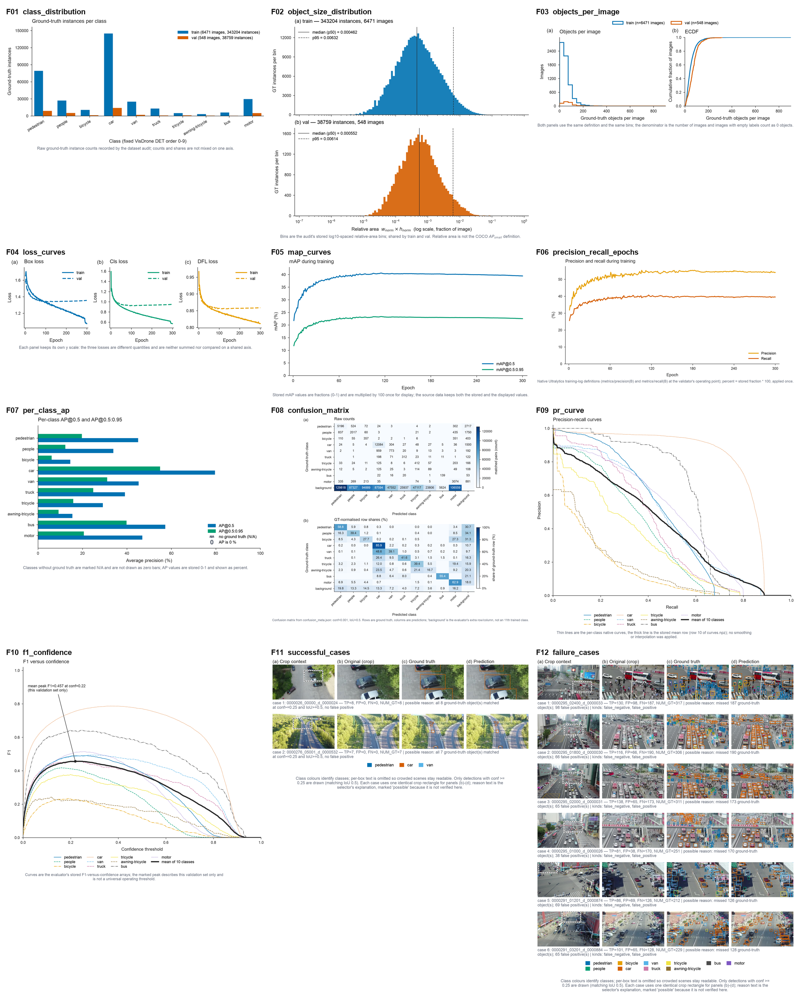
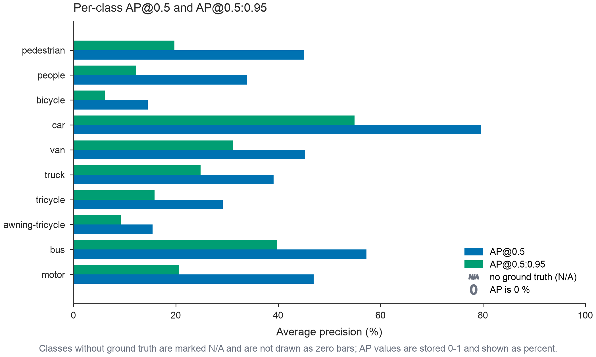
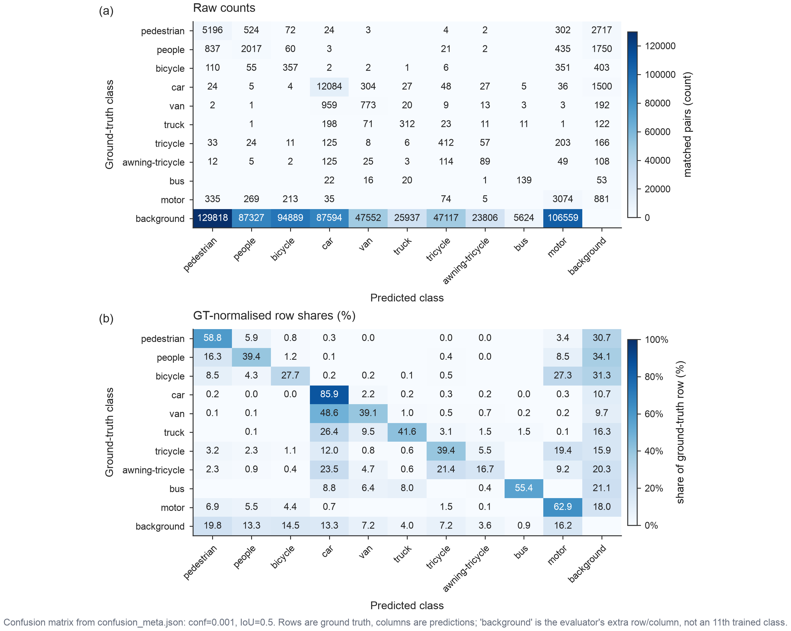
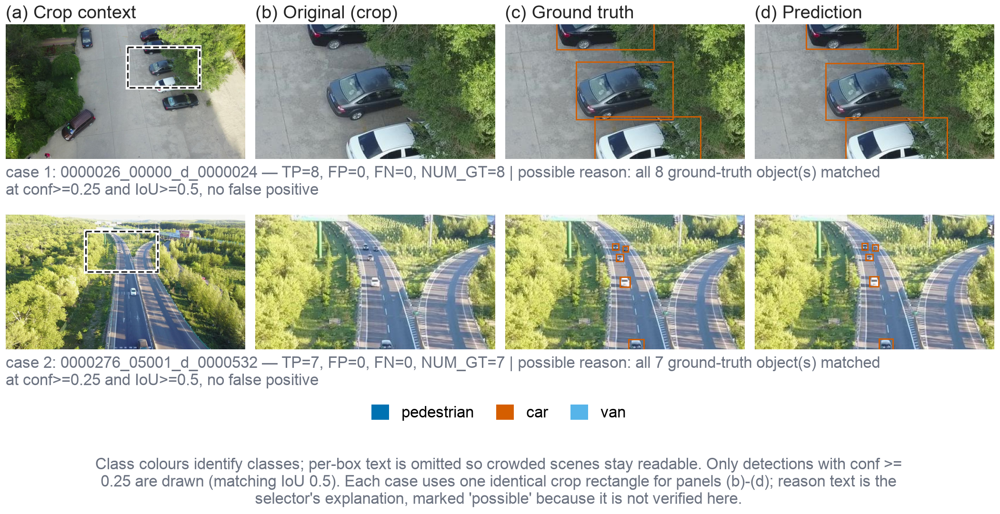
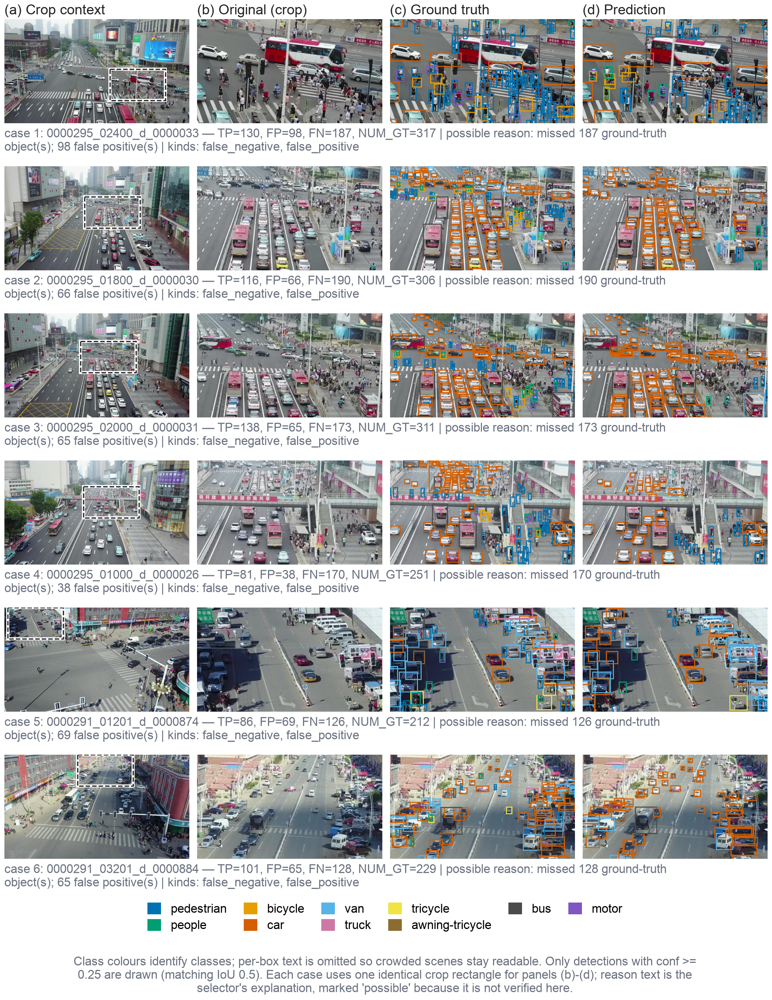

# uavdet — VisDrone2019-DET 无人机小目标检测（YOLO11s）

> 第一次来先看 [00_先看这里.md](00_先看这里.md)：目录地图、结果在哪、哪些文件不能改名。

从零重建的课程项目代码：数据审计、YOLO11s 微调训练、原生验证与原始数组导出、SCI 风格报告图表、
图片/视频/摄像头桌面检测。**不含**旧项目的账户系统、Web 服务、数据库或目标跟踪。

- 数据集：VisDrone2019-DET，10 类固定顺序
  `pedestrian, people, bicycle, car, van, truck, tricycle, awning-tricycle, bus, motor`
- 数据量（本目录自带副本）：train 6471 张、val 548 张，图片与 YOLO 标签一一对应
- 模型：标准 YOLO11s（不实现 ABC 对比、SAHI、P2 等结构改动）
- 训练协议：SGD · lr0=0.01 · lrf=0.01 · 300 epochs · imgsz 640 · batch 16 · 关闭早停
- 产出：`outputs/<run_id>/` 内的权重、逐轮 CSV、指标 JSON/CSV/NPZ、JSONL 预测与 GT、12 类图表素材

> 状态说明：本仓库交付**代码 + 一次云端正式运行结果**。正式 300 轮已在云端 HPC（RTX 4090 D）完成，
> 548 图完整验证，**mAP@0.5 = 40.64%**。原始运行产物保存在本地 `outputs/formal_001/`（约 206 MB，
> **未随仓库提交**）；仓库内的结果图见下方 [Results](#results正式结果) 与 `正式结果_看图/`。

**本机已验证（2026-11-17，Apple M4 CPU）**

| 证据 | 位置 |
|---|---|
| 全量数据审计：7,019 图 / 381,963 实例，train 6471 / val 548 | `outputs/preflight_local_002/audit/` |
| 真实 2 轮 smoke 训练（20/10 图，YOLO11s，CPU） | `outputs/smoke_local_001/train/` |
| 真实验证 + 曲线/矩阵/预测/GT 导出（10 图，mAP50=0.129959，max_det=3000） | `outputs/smoke_local_001/evaluation/` |
| 真实测速（CPU：mean 128.65 ms，FPS 7.77；短清单已告警） | `outputs/smoke_local_001/benchmark/` |
| 真实图表 F01–F10、F12（F11 如实缺项） | `outputs/smoke_local_001/figures/final_v9/` |
| 全量数据图表 F01–F03 | `outputs/preflight_local_002/figures/dataset_v1/` |
| 真实 GUI 推理与结果页（21 目标、11 张缩略图） | `docs/证据截图/界面_运行中.png`、`docs/证据截图/界面_英文_结果页.png` |
| 一条命令跑通真实 pipeline（`smoke_e2e_001`，退出码 7 = 图表缺项） | `outputs/smoke_e2e_001/` |
| **云端正式 300 轮完成**（RTX 4090 D，mAP50=40.64%，548 图评价，12/12 图表） | `outputs/formal_001/` |
| 230 个单元测试通过（30/30 验收编号有对应测试，映射见报告 §5） | 见 §8 与 `IMPLEMENTATION_REPORT.md` |

> 下表里的 `outputs/...` 是本机运行产物，**未随仓库提交**；它们只是"跑过什么"的记录。
> 仓库里可直接浏览的成果是下面的结果图与 `docs/证据截图/`。

---

## Results（正式结果）

`run_id: formal_001` · 云端 300 轮 · 548 张验证图 · RTX 4090 D · ultralytics 8.4.215 · torch 2.5.1+cu121

| 指标 | 值 |
|---|---|
| mAP@0.5 | **40.64%** |
| mAP@0.5:0.95 | **23.46%** |
| Precision / Recall | 54.58% / 40.30% |
| 测速（batch=1, FP32, 100 图×3） | 9.10 ms/图 · **109.9 FPS** |
| 训练耗时 | 300 轮 2.61 h（31.3 s/轮）；best 在第 115 轮 |

逐类 AP@0.5：car 79.65% · bus 57.29% · motor 46.96% · van 45.28% · pedestrian 45.08% ·
truck 39.09% · people 33.88% · tricycle 29.18% · awning-tricycle 15.50% · bicycle 14.51%。



| 逐类 AP | 混淆矩阵 |
|---|---|
|  |  |

| 成功案例（conf≥0.25） | 失败案例（密集/漏检） |
|---|---|
|  |  |

其余 8 张（F01 各类别数量、F02 相对面积、F03 每图目标数、F04 损失曲线、F05 mAP 曲线、
F06 P/R 曲线、F09 PR 曲线、F10 F1–置信度）在 [`正式结果_看图/`](正式结果_看图/)，每张还有
pdf/svg 原件（本地 `outputs/formal_001/figures/v1/`，未提交）。

## 仓库包含 / 不包含

| 包含 | 不包含（以及怎么获得） |
|---|---|
| `src/uavdet/` 全部源码、`tests/`（230 个测试）、`configs/` | `dataset_visdrone/` 的 7019 张图（1.6 GB）：从 [VisDrone 官网](https://github.com/VisDrone/VisDrone-Dataset) 下载，放到 `dataset_visdrone/` |
| `00_先看这里.md`、`README.md`、`IMPLEMENTATION_REPORT.md`、`docs/` | `weights/yolo11s.pt`（COCO 预训练，18 MB）：`python -m uavdet --config configs/project.yaml fetch-weights` 自动下载 |
| `正式结果_看图/`（12 张结果 PNG）、`docs/证据截图/` | `outputs/`（训练权重、预测 JSONL、原始图表，共约 350 MB）：按 README 命令重跑生成 |
| `requirements-*.txt`、`pyproject.toml` | `.venv/`、`workspace/`、`dist/`（本地环境与打包产物） |

> 依赖与数据许可：代码依赖 **Ultralytics YOLO（AGPL-3.0）**；VisDrone 数据集仅限学术研究使用，
> 本仓库不再分发数据与训练权重。仓库未附 LICENSE，默认保留所有权利。

---

## 1. 安装

```bash
cd Project/uav_detection_rebuild

# 1) 创建独立环境（不要污染系统环境）
python3 -m venv .venv
. .venv/bin/activate

# 2) 先装与平台匹配的 torch/torchvision（CPU 版示例；CUDA 版见 6.1）
pip install torch torchvision

# 3) 装其余依赖并做可编辑安装
pip install -r requirements-core.txt
pip install -e . --no-deps

# 4) 桌面界面（可选；云端不需要）
pip install -r requirements-gui.txt

# 5) 想精确复现本机验证过的版本（推荐）：
#    pip install torch==2.0.1 torchvision==0.15.2      # 或对应 CUDA 版本
#    pip install -r requirements-verified.txt
```

已验证的组合（macOS 27.0.1 arm64 / CPU）：Python 3.11.3、torch 2.0.1、torchvision 0.15.2、
ultralytics 8.4.215、numpy 1.26.4、pandas 1.5.3、matplotlib 3.7.1、Pillow 13.0.0、
opencv-python 4.10.0.84、PyQt6 6.12.1，精确列表见 `requirements-verified.txt`。

> 环境诚实说明：本机 venv 是用 `python3 -m venv --system-site-packages .venv` 建在 Anaconda
> 3.11.3 之上的（torch/pandas/matplotlib/Pillow/scipy 来自基础环境），所以上面的版本是"实测可用"
> 的组合，而不是一个新的干净 venv 自动装出来的结果。干净环境请按 §1 的步骤 2→5 安装。
> **没有已验证的 GPU/CUDA 组合**，见 `docs/CLOUD_RUN.md`。

## 2. 数据与预训练权重

- 数据默认位置：`dataset_visdrone/`（本目录自带，运行期视为**只读**）。
  换机器/挂载路径用 `--data-root /path/to/dataset_visdrone` 或配置 `data.root`，
  源码里没有本机绝对路径。
- 审计实测（已验证）：train 6471 图 / 343,204 实例，val 548 图 / 38,759 实例；每图目标数
  train 中位 42、最大 **902**，val 中位 65、最大 **317**；相对面积 `w_norm*h_norm` 中位约
  4.6e-4（小目标为主）。原始数据里只有 **1 条无效标注**（0 像素高度），按
  `data.label_repair: drop_degenerate_boxes` 记录后丢弃到派生视图，源文件不动；
  `data.label_repair: strict` 可复现"原始数据不合法"的严格结论。
- 由此在**正式训练前**做了记录在案的决定：评价 `eval.max_det=3000`。同一 smoke val 上只改这一项
  测得 mAP50 = 0.126582(300) / 0.127566(500) / 0.128731(1000) / 0.129476(2000) /
  0.129959(3000) / 0.130398(5000)，耗时不变，3000→5000 只再涨 0.00044，因此取 3000 作拐点；
  GUI/predict/benchmark 的应用速度设置仍为 300。
- `metrics.json` 会写两条必须复核的告警：`max_det_hits`（本 smoke 10/10 图触顶）和
  `zero_area_detections`（裁剪后零面积框，634 个）。正式 run 如果仍然触顶，说明还需要更高上限或
  更合理的评价 conf，不能当作没发生。
- 预训练权重：默认 `weights/yolo11s.pt`，必须显式准备。程序**不会**自动下载大文件：

  ```bash
  # 显式下载（失败就退出，不会退化成随机初始化）
  python -m uavdet --config configs/project.yaml fetch-weights --name yolo11s.pt
  # 或者手动放到 weights/yolo11s.pt
  ```

  训练前会检查文件存在并记录 SHA256。新训**不接受** `best.pt`/`last.pt` 或任何
  10 类 VisDrone 权重作为起点（除非显式设置 `train.allow_trained_init: true`）。

## 3. 命令

```bash
python -m uavdet --help
python -m uavdet --config configs/project.yaml check --run-id preflight_001 --data-root dataset_visdrone
```

| 命令 | 主要参数 | 作用 |
|---|---|---|
| `check` | `--run-id --data-root --device` | 数据审计 + 环境记录；不训练、不下载 |
| `train` | `--run-id --data-root --device [--resume last.pt] [--epochs --batch]` | 审计通过后训练/恢复 |
| `val` | `--run-id [--weights] [--split] --parent-run-id [--force] --device` | 原生验证 + 原始数组/预测/GT 导出；同一 run 重验证默认拒绝，改新 run_id |
| `benchmark` | `--run-id [--weights] [--images] [--force] --device` | 固定清单测速（batch1、FP32、100 图×3 次） |
| `plot` | `--run-id [--figure-tag]` | 只读已保存结果出图，不加载模型 |
| `predict` | `--weights --source --out --device` | 无 GUI 图片推理（部署检查） |
| `pipeline` | `--run-id [--continue] [--figure-tag]` | check→train→val→benchmark→plot |
| `fetch-weights` | `--name --dir [--force]` | 显式下载官方预训练权重 |
| `info` | — | 打印解析后的配置、路径、已装版本、已有 run |

规则：已完成的 `val`/`benchmark` 阶段默认拒绝在同一 run 重跑（退出码 4）；要重新验证请用新的
`--run-id` 并加 `--parent-run-id <原run>` 记录来源，只有明确要覆盖时才加 `--force`。正式
`pipeline` 还会检查两道闸门：验证必须覆盖 548 张、测速必须拿到 100 张固定清单，否则该阶段记
`failed` 且命令非零退出。

通用覆盖：

```bash
--data-root PATH                  # 覆盖 data.root
--device 0|cpu|mps                # 同时覆盖 train/eval/predict/benchmark 的 device
--override train.epochs=300       # 任意 section.key，优先级最高
```

退出码：`0` 成功 · `1` 通用失败 · `2` 配置错误 · `3` 数据审计失败 · `4` run/stage 状态冲突 ·
`5` 权重问题 · `6` 评价失败 · `7` 图表缺项（partial）· `130` 手动中断。

### 3.1 小样本 smoke（先跑这个）

```bash
python -m uavdet --config configs/smoke.yaml pipeline --run-id smoke_gpu_001 --device 0
```

smoke 会从**完整审计后的数据**中确定性地取 20 张 train / 10 张 val，训练 2 轮。
所有产物带 `scope: smoke`；`report.build_figures` 会拒绝把 smoke 产物混进 formal run。

### 3.2 正式训练与完整验证（云端、获得授权后）

```bash
# 一次跑完
python -m uavdet --config configs/project.yaml pipeline --run-id formal_001 --device 0

# 或分阶段（便于查错）
python -m uavdet --config configs/project.yaml check     --run-id formal_001 --device 0
python -m uavdet --config configs/project.yaml train     --run-id formal_001 --device 0
python -m uavdet --config configs/project.yaml val       --run-id formal_001 \
  --weights outputs/formal_001/train/weights/best.pt --device 0
python -m uavdet --config configs/project.yaml benchmark --run-id formal_001 \
  --weights outputs/formal_001/train/weights/best.pt --device 0
python -m uavdet --config configs/project.yaml plot      --run-id formal_001 --figure-tag v1
```

中断恢复（同一个 run，同一个 checkpoint）：

```bash
python -m uavdet --config configs/project.yaml train --run-id formal_001 \
  --resume outputs/formal_001/train/weights/last.pt --device 0
```

> 改 batch/学习率/数据 = 新 run。`open_run` 用协议指纹（`protocol_digest`）拒绝把新协议
> 追加到已完成实验上；只允许迁移机器时改根路径/device/workers，并记为 `config_rebase` 事件。

### 3.3 只重新验证（无新训练）

```bash
python -m uavdet --config configs/project.yaml val --run-id reval_001 \
  --weights /path/to/trained/best.pt --data-root /path/to/dataset_visdrone --device 0
python -m uavdet --config configs/project.yaml plot --run-id reval_001
```

该 run 只声明验证完成；图表清单会把 F04–F06 列为 `not_applicable`（不会拿旧曲线冒充新训练）。

## 4. 桌面界面

```bash
python -m uavdet.app          # 或安装后执行 uavdet-app
```

界面右上角有 **English / 中文** 切换按钮：一键在整个界面（导航、按钮、表头、状态提示、拖到数据表格的分类名）之间切换，
选择会写入 `<app_data_root>/settings.json` 的 `language` 字段，下次启动保持；切换时当前图片、检测结果和已载入的
实验目录都会保留，**正在运行任务时拒绝切换**（不会销毁运行中的线程）。默认中文。

四个页面：

1. **图片检测**：选择/预览图片 → 检测 → 结果表 → 当前图片分类计数 → 导出标注图 + CSV
2. **视频与摄像头**：选视频文件或摄像头序号 → 开始/停止 → 帧显示 + 当前帧目标数 → 保存当前帧
3. **模型与参数**：10 类权重路径、conf/iou/max_det/imgsz/device、加载状态、参数持久化
4. **实验结果**：选 run 目录 → 真实阶段状态、指标、已保存图表、smoke/formal 标识与缺项提示

界面为深色主题；模型只由工作线程持有，主线程不调用推理；视频/摄像头停止用线程安全事件，
正常结束、异常、关窗都会释放 `VideoCapture`。摄像头在无设备机器上会提示打开失败（**未验证实机**）。

## 5. 结果目录

```text
outputs/<run_id>/
  manifest.json            run_id、scope、协议摘要、各 stage 状态、事件
  config_resolved.yaml     实际解析配置
  environment.json         Python/包/设备真实信息
  audit/                   data_manifest.json、dataset_stats.json、issues.csv
  train/                   args.yaml、results.csv、train.log、weights/{best,last}.pt
  evaluation/              metrics.json、per_class.csv、curves.npz(+meta)、
                           confusion_matrix.npz(+meta)、predictions.jsonl、
                           ground_truth.jsonl、cases.json、evaluation.log
  benchmark/               image_list.json、timings.csv、summary.json
  figures/<tag>/           *.png|pdf|svg、source_data/、figure_manifest.json、figure_index.md
  logs/                    events.jsonl
```

stage 状态：`pending/running/complete/failed/interrupted/skipped`。`skipped ≠ complete`。
已完成的 stage 默认拒绝重跑；`plot` 用新 `--figure-tag` 重画，不覆盖旧的图。

## 6. 常见问题

| 现象 | 原因与处理 |
|---|---|
| `config file not found` / 路径跑到别处 | 配置内相对路径一律相对配置文件解析，再相对 `project.root`；用 `--data-root` 覆盖数据位置 |
| `data root not found` | `dataset_visdrone/` 未随代码上传；确认挂载路径并 `--data-root` |
| `dataset audit failed … image_count_mismatch` | 数据被增删；核对 train=6471 / val=548，确实换数据才改 `expected_*` 并记录 |
| `corrupt_image` / `invalid_label` | 审计会列出 split/图片/原因（`audit/issues.csv`），修复或换数据；不会继续训练 |
| `run already exists with a different training protocol` | 改了 batch/lr/数据/轮数 → 换 `--run-id` |
| `stage 'train' is already complete` | 同一个 run 不允许覆盖已完成阶段；重训请新 run 或显式 `--resume` |
| `weights not found` / 权重被拒 | 先 `fetch-weights` 或手动放 `weights/yolo11s.pt`；`best.pt` 只能用于 `val`，不能当 COCO 起点 |
| `no CUDA GPU is available; falling back to CPU` | 你指定了 GPU 但环境没有；这是**显式警告**，会写进日志与环境记录 |
| `no figure manifest for tag` / 图表缺项 | 缺对应输入（未训练/未验证），`figure_index.md` 会列出缺项原因；不会造空白图 |
| `figures/<tag> already has a figure_manifest.json` | 换 `--figure-tag`；改字体/配色也必须换 tag |
| GUI 无法启动 | 没装 PyQt6（`pip install -r requirements-gui.txt`），或远程无显示；CLI 不依赖 Qt |
| matplotlib 字体/缓存告警 | 无写权限的 `~/.matplotlib` 会自动改用临时目录；中文出图需装 CJK 字体 |

## 7. 图表素材（F01–F12）

| 编号 | 文件 | 用途（报告小节） |
|---|---|---|
| F01 | `class_distribution` | 类别不均衡 → Dataset |
| F02 | `object_size_distribution` | 相对面积分布，说明小目标问题 → Dataset |
| F03 | `objects_per_image` | 场景密度 → Dataset |
| F04 | `loss_curves` | box/cls/dfl 训练 vs 验证 → Training |
| F05 | `map_curves` | mAP50 / mAP50-95 → Training |
| F06 | `precision_recall_epochs` | 训练日志原生 P/R → Training |
| F07 | `per_class_ap` | 逐类 AP50 / AP50-95（无 GT 为 N/A） → Results |
| F08 | `confusion_matrix` | 原始计数 + 按 GT 归一化 → Results |
| F09 | `pr_curve` | 真实 PR 数组 → Results |
| F10 | `f1_confidence` | F1–confidence → Results |
| F11 | `successful_cases` | conf=0.25 成功案例（原图裁剪/GT/预测并列）；严格判据无候选时用记录在案的第二级判据，两级都没有就如实缺项 → Qualitative |
| F12 | `failure_cases` | 漏检/误检/遮挡案例 + 同一裁剪框的局部放大 → Qualitative |

**图面文字全部英文**（标题、坐标轴、图例、图注、缺项说明都一样），绘图代码里也没有中文；
测试 `tests/test_figures.py::EnglishOnlyFigureOutputTests` 会在"工程路径含中文"的情况下渲染一遍并断言
输出里没有中文字符。图产物内的路径是 run-relative 或 `external/<文件名>`，不会写入本机绝对路径。

每张图在 `figure_manifest.json` 里记录输入路径与 SHA256、变量/单位/类别序、筛选与归一化、
样本数、软件/样式版本、输出尺寸；`source_data/` 保存实际绘图数值。照片面板是栅格内容，
只有文字和曲线是可编辑矢量。**smoke 结果不会混入正式结果**（程序按 scope 拒绝混用）。

## 8. 测试

```bash
python -m compileall -q src tests
python -m unittest discover -s tests -v
```

单元测试全部使用临时目录里的合成数据（假模型/假指标），不下载权重、不读真实数据集、
不写 `dataset_visdrone/`。GUI 测试需要 PyQt6，否则显式 skip；离屏用 `QT_QPA_PLATFORM=offscreen`。
真实模型集成测试需要显式提供权重（见 `tests/helpers.py` 与 `IMPLEMENTATION_REPORT.md`）。

## 9. 参考与来源

- 图表风格沿用旧项目的 SCI 风格实现，已内置为本包资源
  （`src/uavdet/plotting/assets/sci-report.mplstyle`）。
- 云端流程：`docs/CLOUD_RUN.md`；实现与验证记录：`IMPLEMENTATION_REPORT.md`。
- 课程资料与旧项目代码未包含在本仓库。
